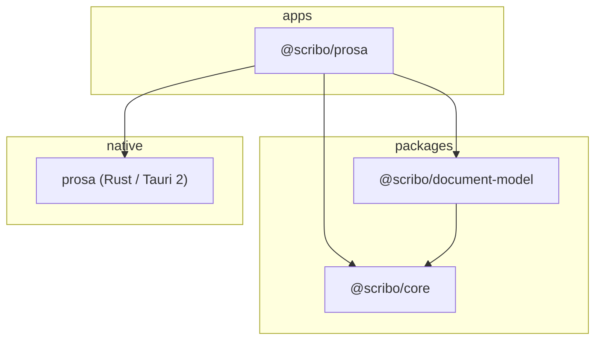

# Scribo architecture (initial milestone)

Scribo is a pnpm monorepo: desktop apps under `apps/`, shared TypeScript under `packages/`, and Rust native code colocated with each Tauri app (`apps/prosa/src-tauri`). A root `Cargo.toml` workspace includes the Prosa Tauri crate.

## Dependency direction

| Layer                    | Responsibility                                                      |
| ------------------------ | ------------------------------------------------------------------- |
| `@scribo/core`           | IDs, metadata contracts, domain errors (no UI, I/O, or React)       |
| `@scribo/document-model` | Canonical Prosa schema, validation, JSON serialization              |
| `@scribo/prosa`          | Shell UI, TipTap integration, typography CSS, Tauri invoke adapters |
| Rust / Tauri             | Local filesystem persistence, OS integration                        |

Future packages (`editor`, `rendering`, `design-system`, `export`) stay out of the tree until they have a concrete boundary. TipTap lives in the app for now; the canonical model remains independent of TipTap types.

**Product direction:** [PRODUCT_CONSTITUTION.md](./PRODUCT_CONSTITUTION.md) and [ROADMAP.md](./ROADMAP.md). **Current code map:** [ARCHITECTURE_AUDIT.md](./ARCHITECTURE_AUDIT.md).

## Document flow

1. **Authoritative state** — `ProsaDocument` JSON (validated by `@scribo/document-model`).
2. **Editing** — TipTap enforces a constrained schema; updates convert TipTap JSON → canonical model.
3. **Presentation** — CSS variables in `manuscript.css` style semantic elements globally (no per-node font overrides in the model).
4. **Persistence** — Tauri commands read/write `document.json`, `meta.json`, and `recovery.json` under the app data directory.

## Toolchain (pinned in repo)

- Node.js ≥ 22, pnpm 10.33.0
- TypeScript ~6.0.3, Vite 8, React 19, Tauri 2
- Rust stable (required for `pnpm tauri:dev`; install via [rustup](https://rustup.rs/))
