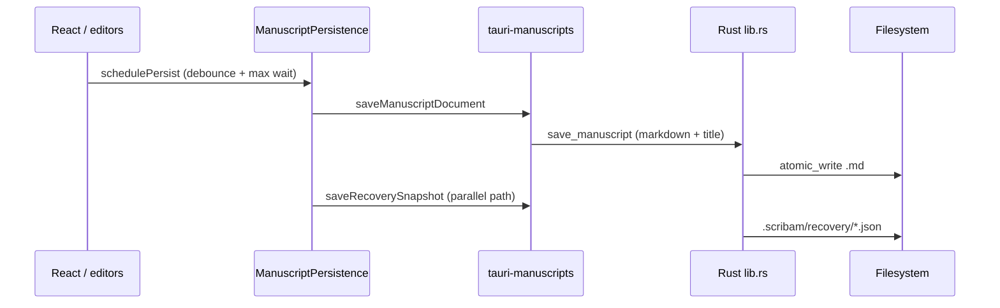

# Architecture audit (baseline)

**Date:** 2026-10-26  
**Reference:** Plan 003 §7 (product architecture principles)  
**Constitution:** [philosophy.md](../product/philosophy.md)

This maps **today's Prosa codebase** to the target subsystems. Refresh when major features land.

---

## Target subsystems → current state

| Subsystem                    | Target role                                    | Current implementation                                                                                                | Gap / notes                                                                                                             |
| ---------------------------- | ---------------------------------------------- | --------------------------------------------------------------------------------------------------------------------- | ----------------------------------------------------------------------------------------------------------------------- |
| **Canonical document model** | Content + semantic structure; no UI/Tauri deps | `@scribam/document-model` (`ProsaDocument`, validation, JSON)                                                         | Stable block IDs still regenerated on some TipTap conversions ([known-limitations.md](../product/known-limitations.md)) |
| **Editor adapter**           | Classic + Markdown; explicit sync rules        | TipTap (Classic) in `EditorWorkspace`; Markdown via CodeMirror + `prosa-markdown.ts`                                  | Round-trip tests exist for markdown; blockquote modeling limited                                                        |
| **Annotation engine**        | Analysis separate from content                 | Partial: `markdown-dialog-highlight`, `markdown-active-sentence` (presentation only)                                  | No provenance, categories, or non-mutating analysis store                                                               |
| **Project knowledge store**  | Entities, sources, links                       | Not present                                                                                                           | Phase 4–5                                                                                                               |
| **Revision subsystem**       | Checkpoints, diffs, restore                    | Not present (only crash **recovery** snapshot)                                                                        | Phase 2 — [revision-history-v1.md](./specs/revision-history-v1.md)                                                      |
| **Persistence boundary**     | Local I/O, migration, external change          | Rust: `library.rs`, `persistence.rs`, Tauri commands in `lib.rs`; TS: `tauri-manuscripts.ts`, `ManuscriptPersistence` | Library `.md` + `.scribam/recovery`; internal legacy `ms_*` folders                                                     |
| **Export / rendering**       | Output without mutating canonical              | Global CSS (`manuscript.css`); no DOCX/PDF pipeline                                                                   | Deferred                                                                                                                |
| **Integration boundary**     | Optional cloud/storage adapters                | None                                                                                                                  | Phase 7                                                                                                                 |

---

## Persistence flow (library manuscript)

**Invariants touched:** write ordering via `ManuscriptPersistence.revision` / `inflightRevision`; recovery via `recovery-policy.ts` on open.

---

## Key paths

| Concern                      | Location                                                        |
| ---------------------------- | --------------------------------------------------------------- |
| Autosave engine              | `apps/prosa/src/features/persistence/manuscript-persistence.ts` |
| Recovery policy              | `apps/prosa/src/features/persistence/recovery-policy.ts`        |
| Disk revision compare        | `apps/prosa/src/features/persistence/document-revision.ts`      |
| Library scan / save / delete | `apps/prosa/src-tauri/src/library.rs`                           |
| Legacy internal storage      | `apps/prosa/src-tauri/src/persistence.rs`                       |
| Markdown ↔ Prosa             | `apps/prosa/src/features/markdown/prosa-markdown.ts`            |
| Normalize on library save    | `apps/prosa/src/features/markdown/markdown-normalize.ts`        |

---

## Classic / Markdown synchronization

- **Source of truth on disk:** Library manuscripts → normalized Markdown file.
- **In memory while editing:** `ProsaDocument` drives both surfaces; Markdown mode edits source string converted through `markdownToProsaDocument` / `prosaDocumentToMarkdown`.
- **Risk areas for Phase 2:** Revision history must define whether checkpoints store Markdown, Prosa JSON, or both; see spec.

---

## External file change

- `get_manuscript_disk_revision` exposes mtime; UI can warn and offer reload (`App.tsx` external-change banner).
- No automatic merge; reload is explicit (aligns with invariants).

---

## Recommended next engineering steps

1. Finalize [revision-history-v1.md](./specs/revision-history-v1.md) storage format and autosave interaction.
2. Add friction entries from real use → [WRITING_FRICTION_LOG.md](./research/WRITING_FRICTION_LOG.md).
3. When revision ships: extend this audit with new Rust modules and tests.
4. Before annotations: draft **annotation contract** (anchors, invalidation, no silent mutation).
