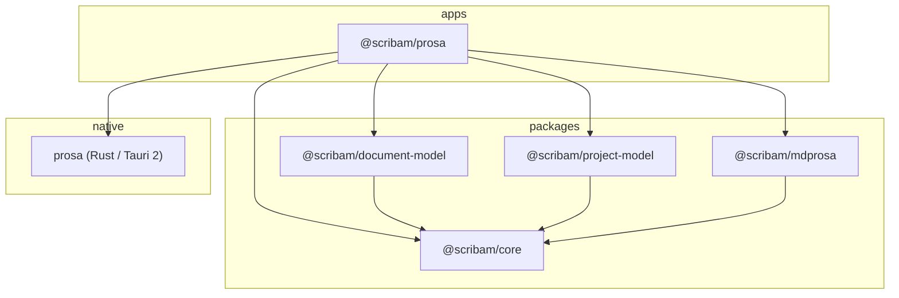

# Scribam architecture (initial milestone)

Scribam is a pnpm monorepo: desktop apps under `apps/`, shared TypeScript under `packages/` (including `@scribam/project-model` and `@scribam/mdprosa`), and Rust native code colocated with each Tauri app (`apps/prosa/src-tauri`). A root `Cargo.toml` workspace includes the Prosa Tauri crate. Multi-app direction: [multi-application-project-architecture.md](../specs/multi-application-project-architecture.md).

## Dependency direction

| Layer                     | Responsibility                                                      |
| ------------------------- | ------------------------------------------------------------------- |
| `@scribam/core`           | IDs, metadata contracts, domain errors (no UI, I/O, or React)       |
| `@scribam/document-model` | Canonical Prosa schema, validation, JSON serialization              |
| `@scribam/prosa`          | Shell UI, TipTap integration, typography CSS, Tauri invoke adapters |
| Rust / Tauri              | Local filesystem persistence, OS integration                        |

Future packages (`editor`, `rendering`, `design-system`, `export`) stay out of the tree until they have a concrete boundary. TipTap lives in the app for now; the canonical model remains independent of TipTap types.

**Product direction:** [philosophy.md](../product/philosophy.md), [prosa-shell-and-projects.md](../product/prosa-shell-and-projects.md) (IDE-like shell, writing-first, Prosa home + project folders), and [roadmap.md](../product/roadmap.md). **Data model:** [data-model.md](./data-model.md). **Code map:** [implementation-audit.md](./implementation-audit.md).

## Document flow

1. **Authoritative state** — `ProsaDocument` JSON (validated by `@scribam/document-model`).
2. **Editing** — TipTap enforces a constrained schema; updates convert TipTap JSON → canonical model.
3. **Presentation** — CSS variables in `manuscript.css` style semantic elements globally (no per-node font overrides in the model).
4. **Persistence** — Markdown manuscripts inside **project folders**; default **Scribam Prosa home** holds those projects (target layout in [prosa-shell-and-projects.md](../product/prosa-shell-and-projects.md)). Recovery under each project’s `.scribam/recovery`. Legacy internal storage may use app-data JSON (see [data-model.md](./data-model.md)).

## Toolchain (pinned in repo)

- Node.js ≥ 22, pnpm 10.33.0
- TypeScript ~6.0.3, Vite 8, React 19, Tauri 2
- Rust stable (required for `pnpm tauri:dev`; install via [rustup](https://rustup.rs/))
