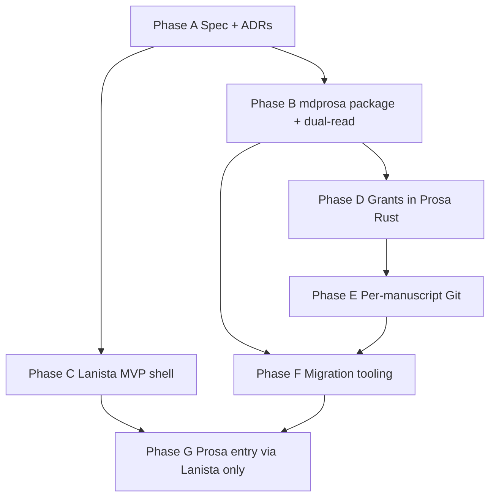

# Plan 006 — Scribo Lanista platform, app sandbox, per-manuscript Git, `.mdprosa`

**Status:** Active (execution track — align with [multi-application-project-architecture.md](../../specs/multi-application-project-architecture.md))  
**Adopted:** 2026-10-26  
**Pauses:** [005-project-workspace-and-git.md](./005-project-workspace-and-git.md) (project-root Git, Prosa-as-hub, `.md` manuscripts)

**Note:** Family architecture spec recommends **unified project Git (Option A)** by default; this plan’s **per-manuscript Git** must be reconciled via [project-git-strategy.md](./project-git-strategy.md) before implementation.

## Executive summary

**Scribo Lanista** is a new **central desktop app** that owns the user’s Scribo **home**, **project catalog**, and **which Scribo app opens which work**. **Scribo Prosa** becomes one **satellite app**: it launches only through Lanista (or equivalent deep link) with a **narrow filesystem contract**—today **only** `content/manuscripts/` inside an opened project.

This plan **re-bases** storage and versioning:

| Topic          | Plan 005 (paused)                         | Plan 006 (direction)                                                                    |
| -------------- | ----------------------------------------- | --------------------------------------------------------------------------------------- |
| Hub            | Prosa manages projects + Git UI           | **Lanista** manages projects; Prosa edits prose                                         |
| Git scope      | One `.git` at **project root**            | One `.git` **per manuscript** (under `content/manuscripts/…`)                           |
| Prose on disk  | `.md` (Markdown)                          | **`.mdprosa`** (Scribo prose format; owned parser package)                              |
| App FS access  | Single Tauri app, full project tree       | **Per-app allowlist**; Prosa cannot read `workspace/`, `knowledge/`, other apps’ trees  |
| Canonical tree | `content/` + optional workspace/knowledge | **`content/manuscripts/` mandatory for Prosa**; other subtrees reserved for future apps |

Plan 005 **philosophy and shipped foundations** (stable block IDs, project manifest, home → project subfolders, IDE-like Prosa shell) **remain**; **execution** of project-level Git, workspace entities, and `.md`-as-source moves under 006 or is **frozen** until migrated.

---

## 1. Scribo Lanista (central app)

### 1.1 Responsibilities

| Lanista owns                                                    | Prosa (and future apps) own                            |
| --------------------------------------------------------------- | ------------------------------------------------------ |
| Default Scribo home path (e.g. `Documents/Scribo/`)             | Editing experience inside granted paths                |
| Project registry (create, rename, remove from catalog, recents) | Manuscript UI, autosave, recovery within allowlist     |
| Launch satellite apps with **project id + capability grant**    | Invoke Rust/TS only within granted roots               |
| Global preferences (optional): default app per project type     | App-local UI state                                     |
| Import/export at **project** level (future)                     | Import/export at **manuscript** level where applicable |

### 1.2 Non-goals (v1)

- Shipping a full “app store” or third-party plugin marketplace.
- Replacing Git with a custom DAG (Git remains the engine **per manuscript**).
- Cloud sync MVP (still gated; see §8).

### 1.3 Technical shape (Recommended)

- **New Tauri app:** `apps/lanista` (name TBD in ADR).
- **IPC / launch:** Lanista spawns Prosa (and later apps) with arguments or env: `SCRIBO_PROJECT_ROOT`, `SCRIBO_GRANT_PATHS` (JSON array of relative paths), `SCRIBO_MANUSCRIPT_ID` (optional).
- **Shared Rust crate(s):** project registry, grant validation, migration runners—**not** duplicated in each app.
- **Config split:** Lanista persists `lanista.json` (or equivalent) in app config; **project** data stays under user-visible project folders.

### 1.4 UX sketch

1. User opens **Lanista** → sees project cards / list (from home + recents + discovery).
2. **Open in Prosa** → Lanista validates manifest, checks Prosa is installed, launches with grants.
3. Prosa window: **no project switcher that escapes grant** (or switcher returns to Lanista).
4. **New project** / **New manuscript** flows originate in Lanista or Prosa but **writes** go through shared library APIs that enforce grants.

---

## 2. Canonical folder structure (forced)

### 2.1 Project layout (normative for 006)

```text
Documents/Scribo/                    # Lanista home (default name TBD in ADR)
├── .lanista/                        # Lanista-local index (optional; not authoritative prose)
└── My Novel/                        # Project folder
    ├── scribo.project.json          # Project manifest + app capability map
    └── content/
        └── manuscripts/             # **Prosa-only** (enforced read/write for Prosa)
            └── ch-01/               # Manuscript package (Recommended)
                ├── ch-01.mdprosa    # Authoritative prose file (v1: one file per package)
                ├── _manuscript.json # IDs, title, schema pointers (tracked in ms Git)
                ├── .git/            # **Per-manuscript** version history
                └── .scribo/
                    └── recovery/    # Crash recovery (not in Git)
```

**Forcing rules:**

- Prosa **must refuse** to open paths outside `content/manuscripts/` (except read-only manifest slice needed for title/id—define minimal manifest API in spec).
- Creating manuscripts **must** create under `content/manuscripts/` only.
- No `.md` manuscripts in Prosa UI after migration window (see §7).
- Future apps get **their own** top-level subtrees (e.g. `content/storyboard/`, `workspace/`) declared in `scribo.project.json`; absent declaration = no access.

### 2.2 Manifest extension (Recommended)

Extend `scribo.project.json` with:

```json
{
  "layoutVersion": 2,
  "apps": {
    "prosa": {
      "allowedRelativePaths": ["content/manuscripts"]
    }
  }
}
```

Lanista validates on open; satellite apps re-validate on every Tauri FS command (defense in depth).

---

## 3. Git per manuscript

### 3.1 Rationale

- **Blast radius:** corrupt merge or bad checkout affects one manuscript, not the whole novel.
- **Alignment with Lanista:** project catalog stays stable while histories diverge per file/tree.
- **Future apps:** non-prose artifacts are not commingled in the same repo as chapter prose unless explicitly linked.

### 3.2 Scope of each manuscript repo (Recommended)

| Tracked in manuscript `.git`          | Not tracked           |
| ------------------------------------- | --------------------- |
| `*.mdprosa`                           | `.scribo/recovery/`   |
| `_manuscript.json`                    | Rebuildable indexes   |
| Optional small sidecars (TBD in spec) | Lanista-only UI state |

**Project-level** `scribo.project.json` changes: either **unversioned** (Lanista writes with explicit “project settings changed”), **Lanista-managed** lightweight repo at project root (`.git` **only** for manifest—**not** prose), or **event log** in `.lanista/`—**decision required** (ADR, §9).

### 3.3 UI impact

- Prosa **Version control** panel scopes to **active manuscript** (branch, dirty, checkpoint, diff)—not whole project.
- Cross-manuscript operations (e.g. “commit all”) are **Lanista** or **explicit multi-select** with clear per-repo semantics—default **off** in v1.

### 3.4 Migration from plan 005 project Git

- Detect existing **project-root** `.git` with prose under `content/manuscripts/`.
- **Split strategy (Recommended):** for each manuscript package, `git filter-repo` or equivalent **or** fresh repo with initial import commit from current working tree; preserve **main** history where feasible; document **history loss** cases in migration spec.
- **Blocking:** do not run split while Prosa has unsaved buffers; Lanista coordinates quiesce or shows hard block.

---

## 4. `.mdprosa` format and `@scribo/mdprosa` (or `@scribo/prosa-format`)

### 4.1 Why not `.md`

- Clear **product boundary**: generic Markdown tools must not treat Scribo files as plain CommonMark without adapters.
- Room for **evolving** syntax (directives, stable IDs, scene markers) without fighting `.md` ecosystem expectations.
- Posterity: versioned **format spec** independent of editor UI.

### 4.2 v1 format scope (Recommended)

- **Superset of today’s normalized Markdown** plus **mandatory** stable block-id encoding (from Phase 1 anchors).
- **Media type / extension:** `.mdprosa`; optional shebang or front matter `scribo-format-version: 1`.
- **Round-trip:** `ProsaDocument` ↔ `.mdprosa` via new package; TipTap/CodeMirror adapters call **only** this package at the boundary (aligns with invariants).

### 4.3 New package

| Package                      | Role                                                                       |
| ---------------------------- | -------------------------------------------------------------------------- |
| `@scribo/mdprosa` (name TBD) | Parse, serialize, validate, normalize; **no** React/Tauri                  |
| `@scribo/document-model`     | Unchanged canonical in-memory model                                        |
| App adapters                 | Thin wrappers; deprecate direct “generic markdown” paths for library saves |

### 4.4 Breaking change

- **One-release** read of legacy `.md` under `content/manuscripts/` with automatic rename to `.mdprosa` on first save (or batch migration tool in Lanista)—mirrors prior root → `content/manuscripts/` migration pattern.
- Explorer / Git / diff filters switch to `.mdprosa` only after migration flag in manifest.

---

## 5. App sandbox (filesystem isolation)

### 5.1 Enforcement layers

1. **Grant at launch** (Lanista → Prosa).
2. **Rust command guard:** every library/Git/path command resolves path under grant; reject with **stable error code** (`ERR_SCRIBO_PATH_FORBIDDEN`).
3. **No “open arbitrary folder” in Prosa** for production builds (developer override behind feature flag only).

### 5.2 Failure mode

| Scenario                            | Behavior                                           |
| ----------------------------------- | -------------------------------------------------- |
| User picks external folder in Prosa | **Blocked**; redirect to Lanista “Add project”     |
| Path traversal in relative key      | **Blocked** at Rust boundary                       |
| Manifest missing `apps.prosa`       | Prosa refuses open; Lanista offers repair template |
| Second app tries Prosa paths        | Denied by grant                                    |

### 5.3 Testing

- Contract tests: given grant `content/manuscripts`, `../workspace/foo` invoke **must** fail.
- Integration: spawn Prosa with narrow grant; verify list/read/write boundaries.

---

## 6. Additional concerns (breaking points, blockers, dependencies)

### 6.1 Breaking points (explicit)

| Change                                 | Who breaks                       | Mitigation                                                                |
| -------------------------------------- | -------------------------------- | ------------------------------------------------------------------------- |
| Prosa no longer default entry          | Users, shortcuts, CI             | Lanista becomes primary binary; Prosa subcommand/deep link; migration doc |
| Project-root Git removed               | Existing repos                   | Split migration tool; backup prompt                                       |
| `.md` → `.mdprosa`                     | External editors, ripgrep habits | One-release importer; reveal in Finder shows new ext                      |
| `library.json` home logic              | Current Tauri config             | Lanista owns catalog; Prosa holds session-only state                      |
| IDE-like project switcher inside Prosa | UX                               | Replace with “Back to Lanista” / open another manuscript via Lanista      |

### 6.2 Blocking errors (must be user-visible, never silent)

- Grant violation (path outside allowlist).
- Manuscript Git repo missing or corrupt (offer re-init with **data loss** warning).
- `.mdprosa` parse failure on load (no empty doc substitution).
- Split migration incomplete (project still on layout v1 with root Git)—block Prosa open until Lanista migration completes.
- Concurrent Lanista + Prosa editing same manuscript without lock policy—**v1: last-writer-wins with mtime warning** (same as today); document as **High** risk for Drive/iCloud.

### 6.3 Dependencies on shipped 005 work

| Shipped                                        | Action under 006                                                   |
| ---------------------------------------------- | ------------------------------------------------------------------ |
| Block ID anchors in Markdown                   | **Port** to `.mdprosa` serializer in new package                   |
| `scribo.project.json` + `content/manuscripts/` | **Extend** layoutVersion; keep path                                |
| Home → project subfolder migration             | **Move** to Lanista; same on-disk outcome                          |
| Project-root Git UI/commands                   | **Refactor** to per-manuscript or **feature-freeze** until Phase B |
| Markdown-only explorer                         | Switch to `.mdprosa`-only after migration phase                    |

### 6.4 Open decisions (ADR / spec gates)

1. Lanista home directory name: `Documents/Scribo` vs retain `Documents/Scribo Prosa` for compatibility.
2. Project manifest versioning: Git at project root for manifest-only vs Lanista event log.
3. Manuscript package: flat `foo.mdprosa` vs directory `foo/foo.mdprosa` (directory recommended for per-ms Git).
4. Multi-window Prosa: one grant per window vs one process per manuscript.
5. Whether Prosa remains installable standalone for dev (bypass grants via env).

---

## 7. Migration program

| Step | Actor                      | Outcome                                                              |
| ---- | -------------------------- | -------------------------------------------------------------------- |
| M0   | Lanista (or migration CLI) | Backup zip prompt                                                    |
| M1   | Lanista                    | Register existing `Documents/Scribo Prosa/**` projects in catalog    |
| M2   | Tooling                    | Rename `.md` → `.mdprosa` under `content/manuscripts/`               |
| M3   | Tooling                    | Split project `.git` → per-manuscript repos (or re-init with import) |
| M4   | Manifest                   | `layoutVersion: 2`, `apps.prosa.allowedRelativePaths`                |
| M5   | Prosa                      | Remove legacy path hooks; grants only                                |

**Rollback:** keep backup zip + manifest flag `migratedFromLayout: 1`; document manual restore—no automatic down-merge.

---

## 8. Phased delivery (implementation)



| Phase | Deliverable                                                                                  | Gate                           |
| ----- | -------------------------------------------------------------------------------------------- | ------------------------------ |
| **A** | [lanista-platform-and-storage.md](../../specs/lanista-platform-and-storage.md), pending ADRs | Human approval before code     |
| **B** | `@scribo/mdprosa` parse/serialize; tests from existing markdown fixtures                     | `pnpm verify`                  |
| **C** | Lanista lists/opens projects; spawns Prosa with grants (dev builds)                          | Manual QA                      |
| **D** | Rust path guard; Prosa refuses out-of-grant I/O                                              | Contract tests                 |
| **E** | Git init/commit/history per manuscript package; Prosa VC panel scoped                        | Interrupt + corrupt repo tests |
| **F** | M1–M5 migration; idempotent                                                                  | Fixture projects in CI         |
| **G** | Release packaging: Lanista primary; docs updated                                             | Changeset                      |

**Pause explicitly:** plan 005 **Phase 4–5** (project-wide branches/merge at root) — no new features until **E** defines per-manuscript merge UX.

---

## 9. Canonical deliverables (this plan)

| Deliverable             | Path                                                                                 | Purpose                                |
| ----------------------- | ------------------------------------------------------------------------------------ | -------------------------------------- |
| **This plan**           | [006-scribo-lanista-platform.md](./006-scribo-lanista-platform.md)                   | Master execution                       |
| Platform & storage spec | [specs/lanista-platform-and-storage.md](../../specs/lanista-platform-and-storage.md) | Source of truth (to author in Phase A) |
| `.mdprosa` format spec  | [specs/mdprosa-format-v1.md](../../specs/mdprosa-format-v1.md)                       | Format contract                        |
| App sandbox spec        | [specs/app-filesystem-grants.md](../../specs/app-filesystem-grants.md)               | Grant enforcement                      |
| Per-manuscript Git spec | [specs/manuscript-git-v1.md](../../specs/manuscript-git-v1.md)                       | Repo layout + UI verbs                 |
| Migration spec          | [specs/layout-v2-migration.md](../../specs/layout-v2-migration.md)                   | M0–M5                                  |
| ADR register            | [decisions/pending-decisions.md](../../architecture/decisions/pending-decisions.md)  | Lanista + layout v2 entries            |
| Roadmap pointer         | [project-architecture-roadmap.md](./project-architecture-roadmap.md)                 | Mark 005 phases paused; link 006       |

---

## 10. Non-negotiables (unchanged)

- Local-first; no silent loss of authored content.
- `@scribo/document-model` canonical for Classic; adapters at app edge.
- Analysis must not silently mutate prose.
- `@scribo/core` free of HTTP, ORM, React, Node I/O.
- Persistence/recovery/schema changes require failure-mode thinking and tests.

---

## 11. Approval gates

1. **Architectural review** — approve Phase A specs (§9) including per-manuscript Git and grant model.
2. **Format review** — approve `.mdprosa` v1 and migration from `.md`.
3. **Implementation** — no production grant enforcement or Git split until gates 1–2 pass.
4. **Release** — Lanista-as-primary requires doc + CHANGELOG + user-visible migration notes.

---

## Related documents

| Document                                                                               | Role                                           |
| -------------------------------------------------------------------------------------- | ---------------------------------------------- |
| [005-project-workspace-and-git.md](./005-project-workspace-and-git.md)                 | Paused; historical Git-at-root direction       |
| [prosa-shell-and-projects.md](../../product/prosa-shell-and-projects.md)               | Update to reference Lanista (follow-up)        |
| [project-architecture-and-storage.md](../../specs/project-architecture-and-storage.md) | Superseded for Git scope; retain audit history |
| [philosophy.md](../../product/philosophy.md)                                           | Product law                                    |
