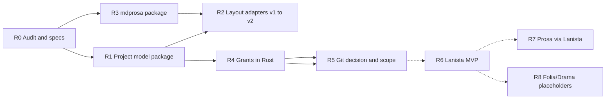

# Multi-application architecture roadmap

**Status:** Draft  
**Master spec:** [multi-application-project-architecture.md](../../specs/multi-application-project-architecture.md)  
**Supersedes for execution planning:** [project-architecture-roadmap.md](./project-architecture-roadmap.md) (005 phases frozen for multi-app track)

## Principles

- **Incremental, reversible** steps; no full rewrite unless audit proves necessary.
- **Preserve working Prosa** behavior until migration gates pass.
- **Standalone apps first.** Prosa owns its hub until a future **paid Lanista** product exists — see [lanista-future.md](../../product/lanista-future.md).

---

## Phase R0 — Specs and review

**Status:** Complete (2026-10-26) — implementation started same day per maintainer direction.

| Item                | Deliverable                                                                                        | Acceptance       |
| ------------------- | -------------------------------------------------------------------------------------------------- | ---------------- |
| Family architecture | [multi-application-project-architecture.md](../../specs/multi-application-project-architecture.md) | Review complete  |
| Format/storage plan | [project-format-and-storage.md](./project-format-and-storage.md)                                   | PFS-1–4 approved |
| Git strategy        | [project-git-strategy.md](./project-git-strategy.md)                                               | E1 scheduled     |
| ADR register        | [pending-decisions.md](../../architecture/decisions/pending-decisions.md)                          | Rows updated     |

**Gate:** Human sign-off before R1 code.

---

## Phase R1 — Shared project types (minimal code)

**Status:** **Shipped** — `@scribo/project-model` (layout, capabilities, manifest extensions).

| Scope | `@scribo/project-model` or extend `@scribo/core` with manifest v2 types only |
| Retain | Existing `ScriboProjectManifest` v1 types |
| Non-goals | FS writes, Git |

**Acceptance:** Typecheck; v1 manifest parses unchanged.

---

## Phase R2 — Layout adapters (Prosa)

**Status:** **Shipped (Rust + TS)** — `project_layout.rs` resolves v1/v2 manuscripts dir; explorer scoped to manuscripts tree.

| Scope | Resolve paths: v1 `content/manuscripts` **or** v2 `contents/canon/manuscripts` |
| Migration | Auto on `init_library`: `content/manuscripts` → `contents/canon/manuscripts`; new projects use v2 |
| Retain | Dual-read v1 until migrated |

**Acceptance:** Unit tests for path resolution + migration; manifest `layoutVersion` bumped to 2.

---

## Phase R3 — `@scribo/mdprosa`

**Status:** **Shipped (foundation)** — format helpers + block IDs; new saves use `.mdprosa`; dual-read `.md`.

| Scope | Parse/serialize v1 markdown + block comments → `.mdprosa` contract |
| Retain | Dual-read `.md` one release |

**Acceptance:** Existing `prosa-markdown` fixtures pass through new package.

---

## Phase R4 — Capability grants (Rust)

**Status:** **Shipped (Prosa)** — `grants.rs` enforces manuscript-tree writes; `ERR_SCRIBO_PATH_FORBIDDEN`.

| Scope | Shared crate; Prosa Tauri commands check grants |
| Interim | Grant = manuscript trees; full project root for Prosa standalone |

**Acceptance:** Contract tests [app-filesystem-grants.md](../../specs/app-filesystem-grants.md).

---

## Phase R5 — Git scope (depends on ADR)

**Status:** **Default locked — Option A** (unified project `.git` per [project-git-strategy.md](./project-git-strategy.md)). Per-manuscript split **deferred** (006 reconciled).

| If Option A | Refactor VC UI filters by domain path; keep project root repo |
| If Option B/C | Implement per [manuscript-git-v1.md](../../specs/manuscript-git-v1.md) + migration |

**Acceptance:** [project-git-strategy.md](./project-git-strategy.md) checklist (production gate still applies).

---

## Phase R6 — Lanista (future paid hub)

**Status:** **Deferred** — no Lanista app in monorepo; [lanista-future.md](../../product/lanista-future.md). Brand assets only.

| Scope | Future: integrated project + app switching (sub-apps TBD) |
| Today | Prosa `library.json` catalog remains authoritative |

**Acceptance:** N/A until product definition and licensing model exist.

---

## Phase R7 — Prosa via Lanista

**Status:** **Cancelled** (standalone Prosa is the shipping entry).

| Former scope           | Superseded by                                        |
| ---------------------- | ---------------------------------------------------- |
| Lanista-only catalog   | Prosa project switcher + `library.json`              |
| Spawn env / hub limits | Removed; optional `SCRIBO_PROJECT_ROOT` for dev only |

**Gate:** Revisit only when R6 product ships.

---

## Phase R8 — Scribo Folia / Drama (future)

**Status:** **Stub** — empty `contents/canon/folia`, `contents/canon/drama`, `contents/shared/*` created on new Prosa projects.

| Scope | App stubs, manifest entries, canon paths only |
| Non-goals | Full editors |

---

## What we keep from 005 / Prosa today

| Asset                              | Action                           |
| ---------------------------------- | -------------------------------- |
| Block ID comments                  | Port to `.mdprosa`               |
| `scribo.project.json`              | Extend, don’t rename without ADR |
| Project-root Git code              | Keep until R5 decision           |
| Explorer, tabs, SCM UI             | Re-scope to grants + domain      |
| Home → project subfolder migration | Prosa-owned for now              |
| Recovery sidecars                  | Per-domain rules TBD             |

---

## What requires migration (not yet)

| Item                                        | Roadmap phase              |
| ------------------------------------------- | -------------------------- |
| `content/` → `contents/canon/`              | R2 + wizard                |
| `.md` → `.mdprosa` on save                  | R3 **shipped** (dual-read) |
| Full layout v2 `contents/canon/manuscripts` | R2 adapter only            |
| Prosa hub → Lanista-only catalog            | R7 **cancelled**           |
| Git split (if any)                          | R5 **deferred (Option A)** |
| Folia/Drama apps                            | R8 stub dirs only          |

---

## Approval gates

1. R0 spec review (this roadmap + multi-app spec).
2. Git ADR (R5) before migration tooling.
3. Future Lanista (R6) requires its own product plan, licensing, and migration doc.

**Final status:** **Ready for architectural review** at R0; implementation **blocked** until gate 1.
