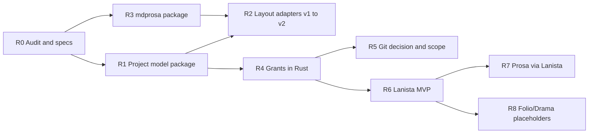

# Multi-application architecture roadmap

**Status:** Draft  
**Master spec:** [multi-application-project-architecture.md](../../specs/multi-application-project-architecture.md)  
**Supersedes for execution planning:** [project-architecture-roadmap.md](./project-architecture-roadmap.md) (005 phases frozen for multi-app track)

## Principles

- **Incremental, reversible** steps; no full rewrite unless audit proves necessary.
- **Preserve working Prosa** behavior until migration gates pass.
- **Lanista:** document current gap (Prosa hub is interim); implement launcher without domain logic.

---

## Phase R0 — Specs and review (current)

| Item                | Deliverable                                                                                        | Acceptance       |
| ------------------- | -------------------------------------------------------------------------------------------------- | ---------------- |
| Family architecture | [multi-application-project-architecture.md](../../specs/multi-application-project-architecture.md) | Review complete  |
| Format/storage plan | [project-format-and-storage.md](./project-format-and-storage.md)                                   | PFS-1–4 approved |
| Git strategy        | [project-git-strategy.md](./project-git-strategy.md)                                               | E1 scheduled     |
| ADR register        | [pending-decisions.md](../../architecture/decisions/pending-decisions.md)                          | Rows updated     |

**Gate:** Human sign-off before R1 code.

---

## Phase R1 — Shared project types (minimal code)

| Scope | `@scribo/project-model` or extend `@scribo/core` with manifest v2 types only |
| Retain | Existing `ScriboProjectManifest` v1 types |
| Non-goals | FS writes, Git |

**Acceptance:** Typecheck; v1 manifest parses unchanged.

---

## Phase R2 — Layout adapters (Prosa)

| Scope | Resolve paths: v1 `content/manuscripts` **or** v2 `contents/canon/manuscripts` |
| Migration | Spec-only until wizard exists |
| Retain | Current user projects on v1 |

**Acceptance:** Unit tests for path resolution; no user migration required yet.

---

## Phase R3 — `@scribo/mdprosa`

| Scope | Parse/serialize v1 markdown + block comments → `.mdprosa` contract |
| Retain | Dual-read `.md` one release |

**Acceptance:** Existing `prosa-markdown` fixtures pass through new package.

---

## Phase R4 — Capability grants (Rust)

| Scope | Shared crate; Prosa Tauri commands check grants |
| Interim | Grant = full project root until Lanista spawns |

**Acceptance:** Contract tests [app-filesystem-grants.md](../../specs/app-filesystem-grants.md).

---

## Phase R5 — Git scope (depends on ADR)

| If Option A | Refactor VC UI filters by domain path; keep project root repo |
| If Option B/C | Implement per [manuscript-git-v1.md](../../specs/manuscript-git-v1.md) + migration |

**Acceptance:** [project-git-strategy.md](./project-git-strategy.md) checklist.

---

## Phase R6 — Lanista MVP

| Scope | `apps/lanista` (new): list projects, register Prosa, spawn with grants |
| Retain | Prosa still openable standalone in **dev** until R7 |

**Verified prerequisite gap:** No Lanista app in repo today — greenfield.

**Acceptance:** Manual QA open project in Prosa via Lanista; catalog persists in Lanista config.

---

## Phase R7 — Prosa production entry

| Scope | Optional: hide hub switcher; “Return to Lanista” |
| Migration | Move `library.json` catalog duties to Lanista |

**Gate:** R4 + R6 + user migration notes.

---

## Phase R8 — Folio / Drama (future)

| Scope | App stubs, manifest entries, canon paths only |
| Non-goals | Full editors |

---

## What we keep from 005 / Prosa today

| Asset                              | Action                           |
| ---------------------------------- | -------------------------------- |
| Block ID comments                  | Port to `.mdprosa`               |
| `scribo.project.json`              | Extend, don’t rename without ADR |
| Project-root Git code              | Keep until R5 decision           |
| Explorer, tabs, SCM UI             | Re-scope to grants + domain      |
| Home → project subfolder migration | Lanista-owned later              |
| Recovery sidecars                  | Per-domain rules TBD             |

---

## What requires migration (not yet)

| Item                           | Roadmap phase |
| ------------------------------ | ------------- |
| `content/` → `contents/canon/` | R2 + wizard   |
| `.md` → `.mdprosa`             | R3            |
| Prosa hub → Lanista            | R6–R7         |
| Git split (if any)             | R5            |
| Folio/Drama trees              | R8            |

---

## Approval gates

1. R0 spec review (this roadmap + multi-app spec).
2. Git ADR (R5) before migration tooling.
3. Lanista primary binary (R7) requires Changeset + migration doc.

**Final status:** **Ready for architectural review** at R0; implementation **blocked** until gate 1.
