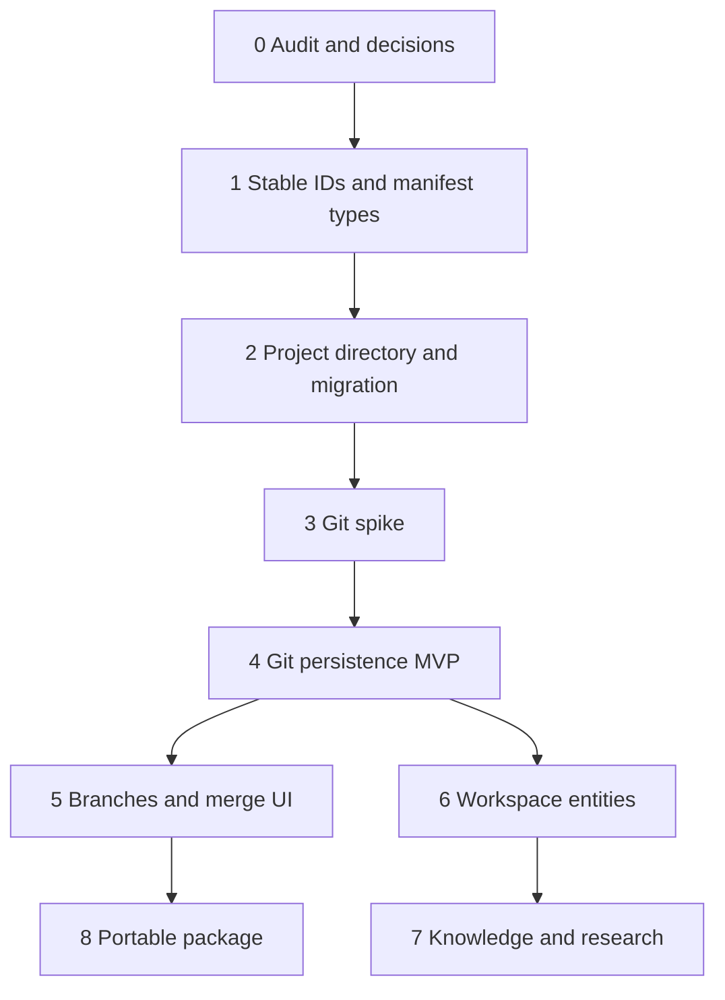

# Project architecture implementation roadmap

**Status:** Draft — **005 execution paused**; new work follows [006-scribo-lanista-platform.md](./006-scribo-lanista-platform.md) phases  
**Depends on:** [project-architecture-and-storage.md](../../specs/project-architecture-and-storage.md) (audit), [lanista-platform-and-storage.md](../../specs/lanista-platform-and-storage.md) (forward)

Phases below describe the **005** track. **Do not start Phase 4–8 extensions** until 006 Phase A specs are approved. Shipped Phase 1–2 remain; project-root Git UI is **legacy** pending per-manuscript migration (006).

## Phase 0 — Audit and decisions (current)

|                  |                                                   |
| ---------------- | ------------------------------------------------- |
| **Objective**    | Approved architecture                             |
| **Deliverables** | This spec, feasibility plan, pending ADR register |
| **Acceptance**   | Human sign-off on §18 open questions              |
| **Gate**         | **You are here**                                  |

**Product direction (locked for planning):** IDE-style shell affordances; **writing-first** scope; **no IDE fork**—OSS building blocks only; **Prosa home → project folders** on disk ([prosa-shell-and-projects.md](../../product/prosa-shell-and-projects.md)).

## Phase 1 — Stable identity

|                |                                                                      |
| -------------- | -------------------------------------------------------------------- |
| **Objective**  | Block/manuscript IDs survive edit round-trips                        |
| **Scope**      | Markdown anchor convention; TipTap convert preserves IDs             |
| **Non-goals**  | Git                                                                  |
| **Depends on** | Phase 0 approval                                                     |
| **Risk**       | High—touches editor core                                             |
| **Status**     | **Shipped (2026-10-26):** comment anchors, markdown + TipTap convert |

## Phase 2 — Project directory + legacy migration

|                  |                                                                                                                   |
| ---------------- | ----------------------------------------------------------------------------------------------------------------- |
| **Objective**    | Open/create `scribo.project.json` + `content/`; import current library                                            |
| **Deliverables** | Rust project module; Tauri commands; UI “Open project”                                                            |
| **Acceptance**   | Existing library imports; single-manuscript project works without Git                                             |
| **Migration**    | Read-only legacy library path still supported one release                                                         |
| **Status**       | **Shipped (2026-10-26):** layout + auto-migrate root `.md` → `content/manuscripts/` on launch (recovery remapped) |

## Phase 3 — Git feasibility spike

|                  |                                                                                 |
| ---------------- | ------------------------------------------------------------------------------- |
| **Objective**    | Evidence for go/no-go                                                           |
| **Deliverables** | [git-spike-results.md](../../research/git-spike-results.md)                     |
| **Gate**         | No Phase 4 if merge or packaging fails criteria                                 |
| **Status**       | **Done (2026-10-26):** `git-spike` feature tests; **go** pending DMG size check |

## Phase 4 — Git history MVP

|                   |                                                                                                                                    |
| ----------------- | ---------------------------------------------------------------------------------------------------------------------------------- |
| **User value**    | Commits, history list, diff, restore                                                                                               |
| **Scope**         | Main branch only; manual or auto-commit policy                                                                                     |
| **Non-goals**     | Multi-branch merge (Phase 5)                                                                                                       |
| **UI (required)** | [Version control panel spec](../../specs/project-version-control-ui.md): branch name, dirty state, checkpoint, commit list         |
| **Acceptance**    | No data loss in interrupt tests; diff at paragraph level; writer sees history without external tools                               |
| **Status**        | **Started (legacy):** project-root Git — **frozen** under 006; migrate to [manuscript-git-v1.md](../../specs/manuscript-git-v1.md) |

## Phase 5 — Branches, merge, conflicts

|                   |                                                                                     |
| ----------------- | ----------------------------------------------------------------------------------- |
| **User value**    | Alternative versions, merge with conflict UI                                        |
| **Depends on**    | Phase 1 IDs, Phase 4                                                                |
| **UI (required)** | Branch create/switch in panel; merge + conflict resolution (not raw `<<<<<<<` only) |
| **Acceptance**    | Scripted merge fixtures pass                                                        |

## Phase 6 — Workspace shell

|                |                                            |
| -------------- | ------------------------------------------ |
| **User value** | Contextual panel: history, outline, tasks  |
| **Scope**      | `workspace/tasks.json`; link to entity IDs |
| **Non-goals**  | Full PM (cycles, epics)                    |

## Phase 7 — Knowledge and research (plan 003 phase 4–5)

|                |                                       |
| -------------- | ------------------------------------- |
| **Scope**      | `knowledge/` entities, sources, links |
| **Depends on** | Stable IDs, project manifest          |

## Phase 8 — Portable `.scribo` package

|                |                                        |
| -------------- | -------------------------------------- |
| **Scope**      | Export/import zip; optional git bundle |
| **Depends on** | Stable project layout                  |

## Phase 9 — Sync & collaboration platform (future)

|                |                                                                                                                                |
| -------------- | ------------------------------------------------------------------------------------------------------------------------------ |
| **User value** | Share projects, backup, optional co-editing—without leaving the writer mental model                                            |
| **Direction**  | **GitHub for writing**: branches, diffs, and review built for manuscripts, not generic repos                                   |
| **Depends on** | Phases 4–8 (local Git, branches/merge, workspace entities, portable `.scribo`)                                                 |
| **Non-goals**  | Exposing raw Git CLI; treating non-markdown files as first-class manuscripts; shipping sync before local-first invariants hold |

## Parallel work

- **Friction log / Phase 0 evidence** — anytime
- **Phase 1** can start after Phase 0 approval **without** Git spike
- **Do not** build analysis/AI (old 003 phase 6) before Phase 6–7 foundations

## Smallest useful deliverable

**Phase 2 + Phase 4 main-branch Git** = writer-visible history on a real project—**after** Phase 1 IDs.
