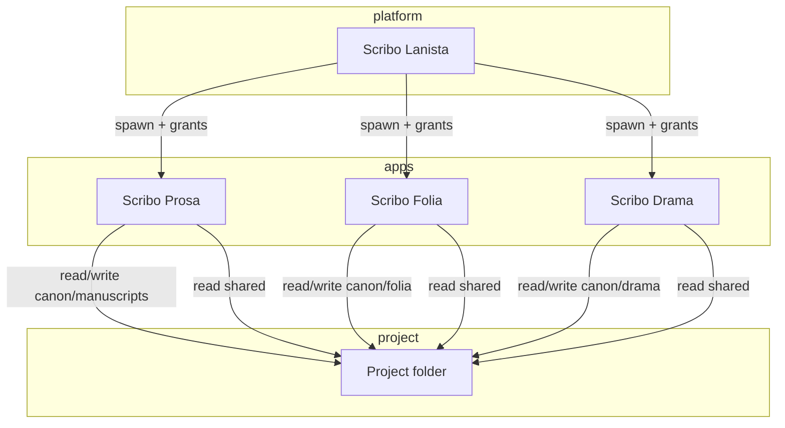
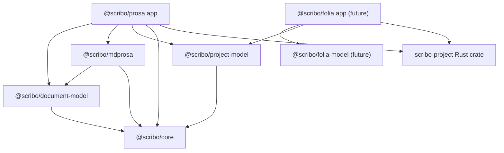

# Multi-application project architecture

**Status:** Draft — awaiting architectural review  
**Scope:** Scribo product family (Lanista, Prosa, Folia, Drama, future apps)  
**Related plans:** [project-format-and-storage.md](../plans/active/project-format-and-storage.md), [project-git-strategy.md](../plans/active/project-git-strategy.md), [multi-application-architecture-roadmap.md](../plans/active/multi-application-architecture-roadmap.md)  
**Prior art:** [project-architecture-and-storage.md](./project-architecture-and-storage.md) (005 audit), [006-scribo-lanista-platform.md](../plans/active/006-scribo-lanista-platform.md) (partial overlap — see §12)

---

## 1. Executive summary

**Recommended direction:**

1. **Three levels:** (a) **Scribo applications** with distinct domain models; (b) **Scribo projects** as user-visible folders; (c) **shared infrastructure** (identity, storage contracts, Git, migrations, integrity) in typed packages and Rust services—not a universal document model.
2. **Scribo Lanista** (future paid hub): integrated project + app switching; satellites (Prosa, Folia, Drama) remain domain apps. **Not shipped** — see [lanista-future.md](../product/lanista-future.md). Prosa is standalone today.
3. **Project layout (evolution):** adopt a **`contents/canon/` + `contents/shared/`** tree (see §5), evolving from today’s verified `content/manuscripts/` via adapters—not a big-bang rename without migration.
4. **Git (default):** **one repository per project** (Option A) tracking all **canonical** paths; **capability checks** at app/Tauri boundaries—not folder names alone. Revisit **domain-separated repos** (Option B) only with measured evidence (§6).
5. **Formats:** **typed extensions** (e.g. `.mdprosa`, future `.folia`, `.drama`) where they encode an **enforceable contract**; shared research/assets use neutral formats + manifest typing.
6. **Packages:** extend `@scribo/core` for project/capability types; add **`@scribo/project-model`** (or split crates) for manifest; domain packages (`@scribo/mdprosa`, future `@scribo/folia-model`) stay product-specific; Rust **`scribo-project`** (name TBD) for FS/Git guards shared by Tauri apps.

**Immediate next action:** Human review of this spec + [project-git-strategy.md](../plans/active/project-git-strategy.md) experiments; **do not** implement until gates in §11 pass.

**Final status (this document):** **Ready for architectural review** (audit complete; Lanista implementation gap documented).

---

## 2. Current-state audit

Evidence classes: **Verified** (inspected in repo), **Documented** (docs only), **Inferred**, **Unknown**.

### 2.1 Monorepo and applications

| Finding                                         | Class               | Evidence                                                                                                                     | Implication                                                                                             |
| ----------------------------------------------- | ------------------- | ---------------------------------------------------------------------------------------------------------------------------- | ------------------------------------------------------------------------------------------------------- |
| Single shipped app: **Scribo Prosa**            | Verified            | `apps/prosa/` only; `pnpm-workspace.yaml` `apps/*`; root `package.json` scripts target `@scribo/prosa`                       | Scribo Folia, Drama, Lanista are not in tree                                                            |
| Rust workspace = Prosa Tauri only               | Verified            | Root `Cargo.toml` members: `apps/prosa/src-tauri`                                                                            | Shared native project crate not extracted                                                               |
| **Scribo Lanista** as runnable launcher         | **Unknown in repo** | Grep: no `apps/lanista`, no Lanista Rust/TS sources; only [006](../plans/active/006-scribo-lanista-platform.md) + stub specs | User-facing “Lanista exists” may refer to **product intent** or **external binary**—not verifiable here |
| Lanista documented as **future** `apps/lanista` | Documented          | [006 §1.3](../plans/active/006-scribo-lanista-platform.md)                                                                   | Conflicts with “already exists” until another repo/path provided                                        |
| **Scribo Folia** (presentations) / **Drama**    | Documented          | `README.md` lists future product lines; no `apps/folia`                                                                      | Naming: **Scribo Folia** (not “Presentation”)                                                           |
| Prosa acts as **interim hub**                   | Verified            | `ProjectSwitcher.tsx`, `library.json` via `library.rs`, `open_project` / `create_project` in `lib.rs`                        | Hub responsibilities live in Prosa today                                                                |

### 2.2 Shared packages

| Finding                                                                    | Class    | Evidence                                     |
| -------------------------------------------------------------------------- | -------- | -------------------------------------------- |
| `@scribo/core` — IDs, errors, `ManuscriptSummary`, `ScriboProjectManifest` | Verified | `packages/core/src/index.ts`, `project.ts`   |
| `@scribo/document-model` — `ProsaDocument`, Zod validation                 | Verified | `packages/document-model/src/prosa/types.ts` |
| No `@scribo/mdprosa`, `@scribo/project-model`, Folia/Drama models          | Verified | Only `core` + `document-model` packages      |
| `@scribo/core` free of HTTP/React/I/O                                      | Verified | `package.json` deps empty; AGENTS.md law     |

### 2.3 Prosa document model and editing

| Finding                                                      | Class    | Evidence                                               |
| ------------------------------------------------------------ | -------- | ------------------------------------------------------ |
| Canonical in-memory: `ProsaDocument`                         | Verified | `document-model`, `App.tsx`                            |
| Classic: TipTap; Markdown: CodeMirror                        | Verified | `EditorWorkspace.tsx`, `MarkdownSourceEditor.tsx`      |
| Disk for library: **Markdown** `.md`                         | Verified | `library.rs` `is_markdown_file`, `walk_markdown_files` |
| Block IDs on disk: HTML comments `<!-- scribo:block=... -->` | Verified | `markdown-block-ids.ts`, tests                         |
| Adapters at app boundary                                     | Verified | `prosa-markdown.ts`, `prosa-convert.ts`                |

### 2.4 Persistence, autosave, recovery

| Finding                                                           | Class    | Evidence                                             |
| ----------------------------------------------------------------- | -------- | ---------------------------------------------------- |
| Debounced autosave 800ms, max wait 3s                             | Verified | `manuscript-persistence.ts`                          |
| Revision counter / inflight serialization                         | Verified | `ManuscriptPersistence.revision`, `inflightRevision` |
| Library save: Rust `atomic_write`                                 | Verified | `atomic_io.rs`, `write_library_markdown`             |
| Recovery sidecars under project `.scribo/recovery/`               | Verified | `library_recovery_path` in `library.rs`              |
| Legacy internal storage `app_data/manuscripts/{id}/document.json` | Verified | `persistence.rs` `manuscripts_root`                  |
| Migration commands for legacy → library                           | Verified | `migrate_*` in `tauri-manuscripts.ts`, `lib.rs`      |

### 2.5 Project layout (today)

| Finding                                                              | Class    | Evidence                                                                                  |
| -------------------------------------------------------------------- | -------- | ----------------------------------------------------------------------------------------- |
| Manifest file: **`scribo.project.json`** (not `project.scribo`)      | Verified | `project.rs` `PROJECT_MANIFEST_FILE`                                                      |
| Manuscripts dir: **`content/manuscripts`**                           | Verified | `CONTENT_MANUSCRIPTS_DIR`                                                                 |
| `layoutVersion` 1 creates `.scribo/recovery` + `content/manuscripts` | Verified | `ensure_project_layout`                                                                   |
| Prosa home + project subfolder migration                             | Verified | `library.rs` `ensure_config_normalized`, `migrate_embedded_project_from_home`             |
| App config: `library.json` — `root_path`, `home_path`, recents       | Verified | `LibraryConfig` in `library.rs`                                                           |
| No `contents/canon/`, no Folia/Drama trees                           | Verified | No code references                                                                        |
| No filesystem **grant** enforcement                                  | Verified | All library ops use full `config.root_path`                                               |
| `workspace/`, `knowledge/` not implemented                           | Verified | Spec only in [project-architecture-and-storage.md](./project-architecture-and-storage.md) |

### 2.6 Git integration

| Finding                                                          | Class    | Evidence                                                               |
| ---------------------------------------------------------------- | -------- | ---------------------------------------------------------------------- |
| Git via **libgit2** (`git2` crate), feature `git-vcs` default on | Verified | `apps/prosa/src-tauri/Cargo.toml`                                      |
| **Project-root** repository                                      | Verified | `ensure_project_git(root)` in `project_git.rs`                         |
| `.scribo/` gitignored in default template                        | Verified | `DEFAULT_GITIGNORE` in `project_git.rs`                                |
| Branch, merge, conflict UI + commands                            | Verified | `project_git.rs`, `SourceControlPanel.tsx`, `MergeConflictOverlay.tsx` |
| Changed-file list filtered to **markdown** under project         | Verified | `list_changed_files` (library/project_git)                             |
| Git **not** per-manuscript today                                 | Verified | Single `Repository::open` at project root                              |
| Feasibility spike tests                                          | Verified | `git_spike.rs`, `verify:git-spike` script                              |

### 2.7 Sync, Drive, integrity

| Finding                                       | Class      | Evidence                                                                         |
| --------------------------------------------- | ---------- | -------------------------------------------------------------------------------- |
| Cloud sync **out of scope**                   | Documented | `RELIABILITY.md`, philosophy/003                                                 |
| Drive/iCloud = **high conflict risk**         | Documented | [project-architecture-and-storage.md §16](./project-architecture-and-storage.md) |
| External edit detection via mtime             | Verified   | `get_manuscript_disk_revision`, `App.tsx` focus handler                          |
| No Drive-specific code                        | Verified   | Repo grep                                                                        |
| Git does **not** make cloud-sync folders safe | Documented | Spec + invariants                                                                |

### 2.8 CI, tests, packaging

| Finding                                                               | Class    | Evidence                                             |
| --------------------------------------------------------------------- | -------- | ---------------------------------------------------- |
| CI: format, lint, typecheck, test, Prosa build; Rust fmt/clippy/check | Verified | `.github/workflows/ci.yml`                           |
| Vitest: persistence, markdown, block IDs                              | Verified | `apps/prosa/**/*.test.ts`                            |
| Rust tests: library, project, project_git                             | Verified | `library.rs`, `project.rs`, `project_git.rs` modules |
| Desktop release workflow                                              | Verified | `.github/workflows/desktop-release.yml`              |
| No Lanista/Folia CI jobs                                              | Verified | CI filters Prosa only                                |

### 2.9 Documentation vs code discrepancies

| Topic              | Docs say                                                                                                                     | Code says            | Resolution                                                                            |
| ------------------ | ---------------------------------------------------------------------------------------------------------------------------- | -------------------- | ------------------------------------------------------------------------------------- |
| Lanista is hub     | [006](../plans/active/006-scribo-lanista-platform.md), [prosa-shell-and-projects.md](../product/prosa-shell-and-projects.md) | Prosa is hub         | Treat Lanista as **target**; audit Prosa hub as **transitional**                      |
| Per-manuscript Git | 006, [manuscript-git-v1.md](./manuscript-git-v1.md) stub                                                                     | Project-root Git     | **Open ADR** — see [project-git-strategy.md](../plans/active/project-git-strategy.md) |
| `.mdprosa`         | 006 stub                                                                                                                     | `.md` only           | Planned migration                                                                     |
| Revision subsystem | [implementation-audit.md](../architecture/implementation-audit.md) says “not present”                                        | Git + recovery exist | Audit stale on Git; recovery ≠ named revisions                                        |

---

## 3. Architectural objectives and invariants

### 3.1 Objectives (from product law)

- Each app owns **domain semantics** and editing UX.
- Shared infrastructure does **not** collapse domains into one document model.
- **Capability-based** access—not “open project folder” full trust.
- **Single authority** per data category; derived indexes rebuildable.
- Version control and migrations **fail closed** with visible errors.
- New apps integrate via **manifest + grants + domain packages**, not forks of Prosa.

### 3.2 Invariants (extended)

| ID  | Invariant                                                                                                      |
| --- | -------------------------------------------------------------------------------------------------------------- |
| I1  | Prosa must not parse or rewrite Folia/Drama canonical files except via explicit import/export tools (future).  |
| I2  | Unknown files under `contents/` remain **preserved** on disk; apps skip or read-only unless capability allows. |
| I3  | Grant checks run at **Rust command boundary** (and optionally TS guard for UX).                                |
| I4  | Autosave → atomic file → optional Git commit ordering documented per domain.                                   |
| I5  | SQLite/indexes under `.scribo/indexes/` are **derived** only.                                                  |

---

## 4. Product family and Lanista



### 4.1 Scribo Lanista (launcher)

| Responsibility                      | Status             | Notes                                                                                  |
| ----------------------------------- | ------------------ | -------------------------------------------------------------------------------------- |
| Discover projects under Scribo home | **Proposed** (006) | **Verified today:** Prosa `list_projects`, `discover_projects_in_home` in `library.rs` |
| Register installed Scribo apps      | **Proposed**       | No registry code                                                                       |
| Open project in compatible app      | **Proposed**       | Prosa: `open_project_root`                                                             |
| Capability grant at launch          | **Proposed**       | [app-filesystem-grants.md](./app-filesystem-grants.md) stub                            |
| Check app availability / version    | **Proposed**       | —                                                                                      |
| Own catalog config (`lanista.json`) | **Proposed**       | **Verified today:** `library.json` in Prosa app config dir                             |

**Boundary rule:** Lanista validates manifest schema, app compatibility, and grants; it does **not** interpret `.mdprosa`, folia decks, or drama scripts.

**Where logic lives (recommended):**

| Concern                                                 | Owner                                                       |
| ------------------------------------------------------- | ----------------------------------------------------------- |
| Project discovery, recents                              | Lanista + shared `@scribo/project-model` types              |
| Manifest read/write (project title, layout, apps block) | Shared Rust/TS library; Lanista writes project-level fields |
| Grant enforcement                                       | Shared Rust crate used by **each** Tauri app                |
| Domain parse/serialize                                  | Domain packages + each app                                  |

### 4.2 Authoring applications

| App          | Domain                                  | Primary canon path (recommended) |
| ------------ | --------------------------------------- | -------------------------------- |
| Scribo Prosa | Manuscripts / long-form prose           | `contents/canon/manuscripts/`    |
| Scribo Folia | Presentations (formerly “Presentation”) | `contents/canon/folia/`          |
| Scribo Drama | Scripts / dramatic structure            | `contents/canon/drama/`          |

---

## 5. Project hierarchy and proposed layout

### 5.1 Hypothesis evaluation (`project.scribo` tree)

User hypothesis:

```text
MyProject/
├── project.scribo
├── contents/
│   ├── canon/
│   │   ├── manuscripts/
│   │   ├── presentations/   → use folia/
│   │   └── drama/
│   └── shared/
│       ├── research/
│       └── assets/
├── .scribo/
│   ├── metadata/
│   └── indexes/
└── .git/
```

**Assessment:** **Directionally appropriate** with naming adjustments:

| Hypothesis element                 | Recommendation                                                                                                                |
| ---------------------------------- | ----------------------------------------------------------------------------------------------------------------------------- |
| `project.scribo`                   | Use **`project.scribo.json`** or retain **`scribo.project.json`** through v2 adapter (avoid two filenames). **ADR required.** |
| `contents/` vs `content/`          | Prefer **`contents/`** for multi-domain clarity; migrate from verified `content/manuscripts` with symlink or one-time move    |
| `canon/`                           | **Yes** — separates authoritative app-owned trees from shared material                                                        |
| `shared/research`, `shared/assets` | **Yes** — read-heavy for all apps; write rules per capability                                                                 |
| `.scribo/metadata`                 | **Derived/local** — project-scoped indexes, not authoritative prose                                                           |
| `.scribo/indexes`                  | **Derived** — rebuildable SQLite/JSON indexes                                                                                 |
| `.git/` at project root            | **Default** — see §6 (Option A)                                                                                               |

### 5.2 Recommended target tree (v2)

```text
MyProject/
├── scribo.project.json          # or project.scribo.json (ADR)
├── contents/
│   ├── canon/
│   │   ├── manuscripts/         # Prosa — .mdprosa (target)
│   │   ├── folia/               # Scribo Folia
│   │   └── drama/               # Drama
│   └── shared/
│       ├── research/            # Neutral notes, biblio, .md or .mdresearch TBD
│       └── assets/              # Binaries; Git LFS or gitignore + sidecar ADR
├── .scribo/
│   ├── recovery/                # Per-app or per-manuscript recovery (domain rules)
│   └── indexes/                 # Rebuildable
└── .git/                        # Unified project repo (default)
```

### 5.3 Authority matrix

| Data              | Authority                   | Canonical location            | Git (default)     |
| ----------------- | --------------------------- | ----------------------------- | ----------------- |
| Prose manuscripts | Prosa + `.mdprosa` contract | `contents/canon/manuscripts/` | Tracked           |
| Presentations     | Scribo Folia + `.folia`     | `contents/canon/folia/`       | Tracked           |
| Drama scripts     | Drama + drama contract      | `contents/canon/drama/`       | Tracked           |
| Shared research   | Shared read; scoped write   | `contents/shared/research/`   | Tracked           |
| Assets            | Manifest + sidecars         | `contents/shared/assets/`     | LFS/gitignore TBD |
| Project identity  | Manifest                    | `scribo.project.json`         | Tracked           |
| Search/backlinks  | Derived                     | `.scribo/indexes/`            | Ignored           |
| Crash recovery    | Ephemeral                   | `.scribo/recovery/`           | Ignored           |
| Lanista catalog   | Lanista app config          | Outside project               | N/A               |

### 5.4 Unknown and unsupported content

- **Preserve bytes** on disk; do not delete in migration.
- Apps **skip** unknown extensions in explorers unless manifest declares a handler.
- Optional **`contents/unknown/`** or leave in place with `application/octet-stream` handling — **Open question** (low priority).

---

## 6. Git strategy comparison

Full decision plan: [project-git-strategy.md](../plans/active/project-git-strategy.md).

| Criterion                         | A: One repo / project    | B: Repo per domain   | C: Hybrid    |
| --------------------------------- | ------------------------ | -------------------- | ------------ |
| Cross-domain atomic commit        | **Strong**               | Weak                 | Medium       |
| Coherent “project milestone”      | **Strong**               | Requires meta-repo   | Medium       |
| Domain isolation (blast radius)   | Weak (path grants only)  | **Strong**           | Medium       |
| Shared assets + references        | **Simple**               | Cross-repo refs hard | Medium       |
| Repo size / binaries              | Single growth            | Split                | Configurable |
| Backup/portable `.scribo` package | **One bundle**           | Multiple bundles     | Complex      |
| Implementation (current code)     | **Matches today**        | Major refactor       | Highest      |
| Multi-app concurrent edit + Drive | **Unsafe** (all options) | **Unsafe**           | **Unsafe**   |

**Default recommendation:** **Option A — one Git repository per project** tracking `contents/` + manifest, with **capability-enforced writes** and domain-specific Git UI filters.

**Revisit Option B or C when:**

- Demonstrated need for **independent release cadence** per domain (e.g. Folia major version without touching manuscript history).
- Project repo exceeds agreed size threshold **and** domain split reduces clone cost materially.
- **Per-manuscript Git** (006) is approved **only for Prosa** as a **hybrid** exception: nested repos under `manuscripts/{slug}/.git` — **high complexity**; requires ADR and forbidden until spike passes (conflicts with unified history).

**Cross-domain change:** Prefer single commit touching `canon/manuscripts/...` and `shared/research/...` when user action spans domains (Lanista-orchestrated “checkpoint project”).

---

## 7. Application capability model

Capabilities are **typed**, declared in manifest — not inferred from folder names alone.

### 7.1 Example manifest fragment (proposed)

```json
{
  "projectSchemaVersion": 2,
  "layoutVersion": 2,
  "apps": {
    "prosa": {
      "appId": "com.scribo.prosa",
      "allowedOperations": {
        "read": ["contents/canon/manuscripts/**", "contents/shared/**", "scribo.project.json"],
        "write": ["contents/canon/manuscripts/**"],
        "createDelete": ["contents/canon/manuscripts/**"]
      },
      "documentTypes": [{ "extension": "mdprosa", "formatVersion": 1 }]
    },
    "folia": {
      "appId": "com.scribo.folia",
      "allowedOperations": {
        "read": ["contents/canon/folia/**", "contents/shared/**", "scribo.project.json"],
        "write": ["contents/canon/folia/**"]
      }
    },
    "drama": {
      "appId": "com.scribo.drama",
      "allowedOperations": {
        "read": ["contents/canon/drama/**", "contents/shared/**", "scribo.project.json"],
        "write": ["contents/canon/drama/**"]
      }
    }
  }
}
```

### 7.2 Capability matrix

| Application | Primary write                          | Shared read | Shared write              | Metadata read |
| ----------- | -------------------------------------- | ----------- | ------------------------- | ------------- |
| Lanista     | Project catalog fields, manifest shell | —           | —                         | Full manifest |
| Prosa       | `canon/manuscripts/**`                 | `shared/**` | **TBD** (research notes?) | Title, ids    |
| Folia       | `canon/folia/**`                       | `shared/**` | TBD                       | Title, ids    |
| Drama       | `canon/drama/**`                       | `shared/**` | TBD                       | Title, ids    |

### 7.3 Validation before write

- Extension + magic/header must match registered `documentTypes`.
- Parse failure → **block save**, show error (invariant: no silent empty doc).
- Wrong app → `ERR_SCRIBO_PATH_FORBIDDEN`.

### 7.4 Registration (not a plugin marketplace)

- **Static registry** in Lanista: app id, binary name, min version, supported layout versions.
- New apps add a row + manifest schema — no dynamic third-party plugins in v1.

### 7.5 Testing

- Contract tests per app: allowed paths succeed; forbidden paths fail.
- Fuzz path traversal on relative keys (see `is_safe_library_path` in `library.rs` — extend for grants).

---

## 8. Document formats and extensions

| Approach                                | Pros                            | Cons                                         | Verdict                              |
| --------------------------------------- | ------------------------------- | -------------------------------------------- | ------------------------------------ |
| 1. Plain `.md` + manifest type          | External editor friendly        | No enforceable boundary; Prosa/Folia collide | **Legacy only**                      |
| 2. Custom extensions (`.mdprosa`, etc.) | Clear contract, tooling filters | External editors need association            | **Recommended for Prosa v2**         |
| 3. Markdown + front matter contract     | Portable                        | Weak enforcement; easy to break IDs          | Complement inside `.mdprosa`         |
| 4. Structured JSON canonical on disk    | Strong schema                   | Poor writer UX for prose                     | Keep **in-memory** (`ProsaDocument`) |

**Prosa:** Recommend **`.mdprosa`** as Markdown-dialect + **`scribo-format-version`** + block anchors ([mdprosa-format-v1.md](./mdprosa-format-v1.md)). Package **`@scribo/mdprosa`** owns parse/serialize/normalize.

**Folia / Drama:** Define extensions when apps exist; do not reuse `.mdprosa`.

**Stable IDs:** Manuscript/project IDs in manifest; block IDs in file via comments (verified pattern); chapter/scene structure via future `_manuscript.json` per package ([project-architecture-and-storage.md §5.5](./project-architecture-and-storage.md)).

---

## 9. Shared packages and dependency direction



| Package / crate                | Owns                                          | Must not              |
| ------------------------------ | --------------------------------------------- | --------------------- |
| `@scribo/core`                 | IDs, errors, cross-app summary types          | I/O, React            |
| `@scribo/project-model`        | Manifest v2, capabilities, layout constants   | Domain prose          |
| `@scribo/document-model`       | Prosa in-memory schema                        | Git, FS               |
| `@scribo/mdprosa`              | `.mdprosa` ↔ `ProsaDocument`                  | UI                    |
| `@scribo/folia-model` (future) | Folia deck schema                             | Prosa types           |
| `scribo-project` (Rust)        | Grant checks, manifest I/O, shared migrations | TipTap                |
| Each Tauri app                 | UI, invoke adapters, editor                   | Duplicate grant logic |

---

## 10. Project identity, versioning, consistency

| Field                         | Authority             | Version domain                         |
| ----------------------------- | --------------------- | -------------------------------------- |
| `projectSchemaVersion`        | `scribo.project.json` | Project-wide migrations                |
| `layoutVersion`               | manifest              | Directory tree migrations              |
| `ProsaDocument.schemaVersion` | in-memory / export    | `@scribo/document-model`               |
| `scribo-format-version`       | `.mdprosa` header     | `@scribo/mdprosa`                      |
| App semver                    | package               | Compatibility checks at Lanista launch |

**Migration ownership:** Rust runs filesystem migrations; TS/domain packages run format migrations on load; manifest records `migratedFromLayout`.

**Unknown JSON fields:** Preserve on read; ignore until app understands.

**Branches with different layout versions:** Block checkout until migration tool runs (fail closed).

---

## 11. Portable `.scribo` package (live vs archive)

- **Live format:** project **directory** (recommended).
- **Portable package:** zip (or tar) with manifest signature, canonical `contents/`, optional **bundled `.git`**, excludes `.scribo/recovery` and indexes (rebuild on import).

Requirements: atomic export, hash manifest, import validation, partial-support import (preserve unknown files).

**Non-goal:** SQLite blob as live store.

---

## 12. Git, sync, and data integrity

| Scenario                        | Required behavior                                                            |
| ------------------------------- | ---------------------------------------------------------------------------- |
| Autosave vs commit              | Autosave = atomic file; Git commit explicit or policy-driven **after** flush |
| Branch switch with dirty editor | Block or stash via recovery; user confirm                                    |
| Multi-domain edit               | Single repo: one commit or split with UI clarity                             |
| Merge conflicts                 | Domain app resolves within its files; shared markers use writer UI           |
| Interrupted write               | Temp + rename (`atomic_write`); recovery sidecar                             |
| Two Prosa instances             | Unsupported v1; mtime warning                                                |
| Drive/iCloud                    | Document **unsafe**; warn on project open                                    |
| Failed schema migration         | Rollback flag; backup from M0                                                |

**Production Git gate:** interrupt tests, corrupt repo tests, grant tests, migration idempotency — see [project-git-strategy.md](../plans/active/project-git-strategy.md).

---

## 13. Relationship to plan 006

| 006 topic                  | This spec                                                           |
| -------------------------- | ------------------------------------------------------------------- |
| Lanista hub                | Aligned — 006 is execution slice of §4                              |
| `content/manuscripts` only | Evolves to `contents/canon/manuscripts`                             |
| Per-manuscript Git         | **Conflicts** with §6 default (unified repo) — **must pick in ADR** |
| `.mdprosa`                 | Aligned §8                                                          |
| Grants                     | Aligned §7                                                          |

**Recommendation:** Treat **this document** as family architecture; update 006 or add ADR to reconcile Git scope.

---

## 14. Open questions (prioritized)

1. **Lanista source of truth:** Same repo vs separate repo? (Currently **not in monorepo** — Verified.)
2. **Manifest filename:** `scribo.project.json` vs `project.scribo.json`.
3. **Git:** Unified (§6) vs per-manuscript (006).
4. **Prosa shared write** to `contents/shared/research/` — yes/no?
5. **Folia on-disk format** — defer until app spike.

---

## 15. Approval gates

1. Architectural review of this spec + layout v2.
2. Git strategy decision after experiments ([project-git-strategy.md](../plans/active/project-git-strategy.md)).
3. Format approval ([mdprosa-format-v1.md](./mdprosa-format-v1.md)).
4. No Lanista app or grant enforcement until 1–3 approved.
