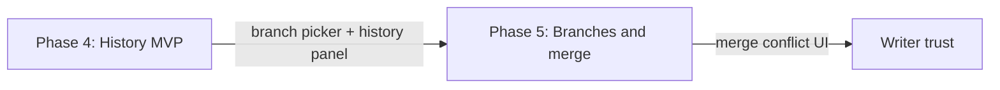

# Writer-visible version control (UI contract)

**Status:** Active (plan 005 Phase 4–5)  
**Parent:** [005-project-workspace-and-git.md](../plans/active/005-project-workspace-and-git.md)

Git is **not** an invisible sync layer. Writers must see and control narrative lines the same way they see manuscripts in the library.

## Non-negotiables

| Requirement                                                     | Phase                       |
| --------------------------------------------------------------- | --------------------------- |
| **Current branch** visible at all times in the project chrome   | 4 (shipped incrementally)   |
| **Searchable branch picker** + create; switch when checkpointed | 4–5                         |
| **Timeline graph** (commits, branch tip nodes)                  | 4                           |
| **Checkpoint / commit** with human-readable message             | 4                           |
| **Diff + restore** from a commit (manuscript or project scope)  | 4 → 5                       |
| **Merge conflicts** surfaced in editor with accept/keep-both    | 5                           |
| Raw Git porcelain, SHA-only UI, or terminal workflow            | **Never** as the primary UX |

## Phase map (user-visible)

- **Phase 4:** Main branch history, manual checkpoints, dirty indicator; sidebar **Changes / Graph** tabs (unified row graph: colored lanes + branch tips + summary, SourceTree-style layout).
- **Phase 5:** Named branches, switch branch, merge with conflict markers resolved in UI.
- **Phase 6+:** Workspace shell may embed the same panel; do not duplicate a second hidden Git UX.

## Acceptance (Phase 4 MVP)

1. Opening a project shows whether Git is initialized and the **current branch name**.
2. User can create a **checkpoint** after save; commit appears in the **Graph** tab without restarting the app.
3. Uncommitted disk changes show **unsaved / uncheckpointed** state distinct from editor dirty state.
4. All actions fail loudly (toast/error)—no silent Git failures.

## Acceptance (Phase 5)

1. User creates branch `experimental`, switches back to `main`, edits, merges—conflicts appear in UI.
2. Branch switch blocked or confirmed when working tree is dirty.

## Out of scope

- GitHub push/pull (later integration tier).
- Blaming lines in editor gutter (optional future).
